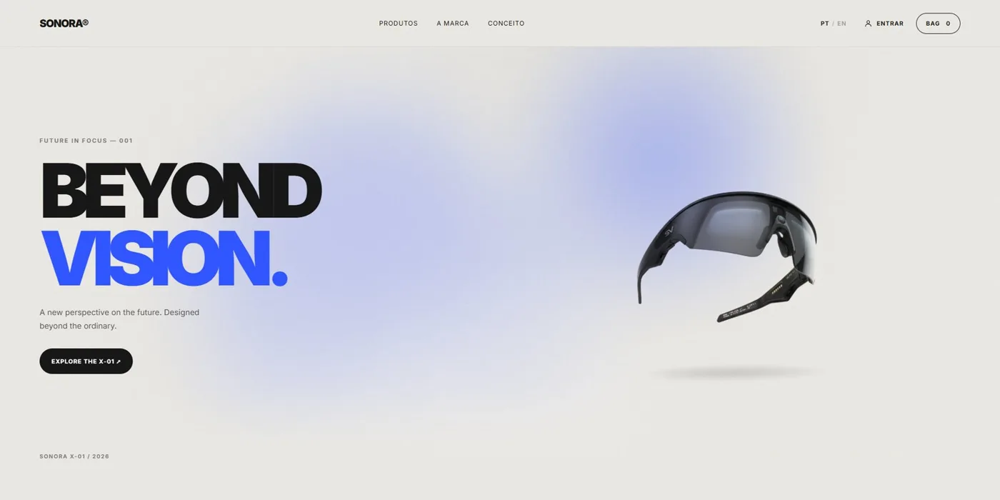
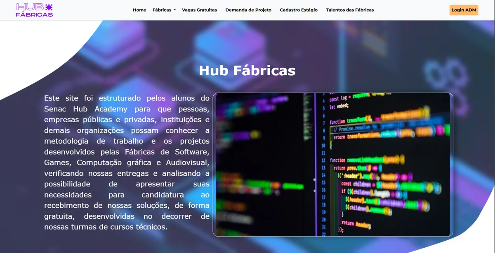

<h1 align="center">Olá, eu sou o Hentony Almeida 👋</h1>

  Desenvolvedor Full Stack em formação · Campo Grande, MS 🇧🇷 
  Construindo experiências digitais modernas.

  
  

---

## 🚀 Sobre mim

- 💻 Desenvolvedor Full Stack em formação, com foco em aplicações web que combinam funcionalidade, design e experiência do usuário.
- 🎓 Tecnólogo em Redes de Computadores (Estácio, 2025) e curso de Desenvolvimento de Sistemas no Senac Hub Academy (2023–2024).
- 🌱 Estudando e construindo projetos próprios para evoluir em back-end, banco de dados e interfaces.
- 🔎 Em busca da minha primeira oportunidade como desenvolvedor.

## 🛠️ Tecnologias

**Uso em projetos**

**Em evolução / aprendendo**

## 📊 GitHub

  
  

## 📁 Projetos em destaque

### SONORA®
Loja virtual full stack de áudio, com catálogo, carrinho, checkout, painel administrativo e interface em português e inglês. O pagamento usa o Stripe em modo de teste.

🔗 [Ver o código](https://github.com/tonyhento/sonora)

### ASTER
Rede social com feed, postagens, perfis e envio de avatar. Projeto de aprendizado, executado localmente.

### SENAC Hub Fábricas
Projeto de conclusão do curso de Desenvolvimento de Sistemas (Senac Hub Academy, 2024): sistema web com área administrativa, gráficos e geração de PDF. Repositório privado.

## 🏅 Formação e certificações

- Tecnólogo em Redes de Computadores — Estácio (concluído em 03/07/2025)
- Certificação intermediária em Administração de Redes — Estácio (320 h)
- Python Essentials 1, Cybersecurity Essentials, Computer Hardware Basics e IT Customer Support Basics — Cisco Networking Academy

---

  Estou aberto a oportunidades como desenvolvedor Full Stack júnior. Vamos conversar? 🤝

